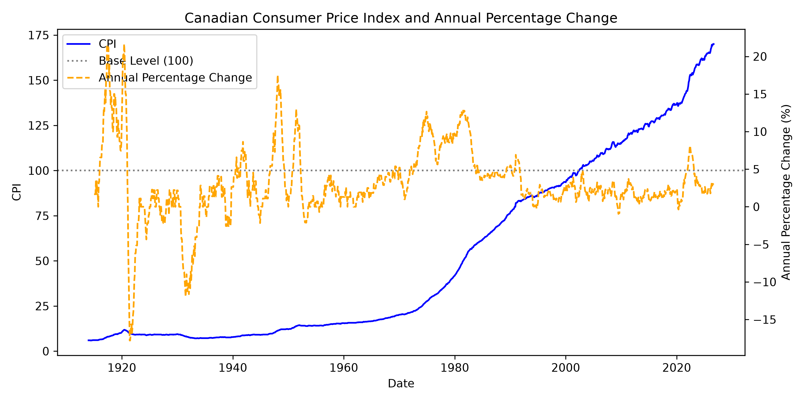

# My Canadian Inflation Calculator

This project uses data from the Canadian Consumer Price Index, which is also from the Bank of Canada to look at inflation over time. The program reads monthly CPI data, creates a graph, and calculates how the value of changes in money between two dates.

I used Python with Pandas, NumPy, and Matplotlib to organize the data, calculate some formulas, and display the results.

## Project Files

InflationCalculator.py: My main Python program. It creates the CPI graph and runs the calculator.
STATIC_INFLATIONCALC.csv: The monthly data downloaded from the Bank of Canada in CSV form.
CPI_graph.png: The graph showing the CPI and its annual percentage change.
ReadMe.md: Where I explain the project and how to use the program.

## How to Run the Program

1. Download the project files and keep them in the same folder.
2. Open the folder in Visual Studio Code.
3. Make sure Python is installed.
4. Install the required libraries using the terminal. Before my program successfully ran, I had to input this into my terminal :

   "python -m pip install matplotlib"

5. Open "InflationCalculator.py" and run the program.
6. The CPI graph will appear in a separate window and will also be saved as "CPI_graph.png".
7. Close the graph window to continue to the calculator.
8. Enter a price and two dates in "YYYY-MM-DD" format.
9. The program will give the inflation calculations.

The calculator uses the month and year from each date. It also checks that the price and dates are valid and that CPI data is available for the selected periods.

## CPI Graph

### Graph Commentary

The graph shows how Canada's CPI has changed over time. Overall, CPI has increased (especially in the later decades), which means that the general price level has risen over the years.

The annual percentage change is less consistent. It moves up and down, showing that inflation does not increase at the same rate every year. Some periods have prices that rise faster and with others, inflation is much lower.

The dotted horizontal line marks the CPI base level of 100.

## Inflation Calculator

The calculator compares CPI values from two selected months to estimate inflation and the equivalent price of goods or services.

It displays the original price, CPI values, percentage change, number of years, annual rate of change, and adjusted price.

### Example Output

**Inputs:**

- Original price: $100.00 CAD
- First date: 2010-01-01
- Second date: 2020-01-01

**Sample results:**

Original Price: $100.00 CAD
First Period: 2010-01
Second Period: 2020-01
First Period CPI: 115.1
Second Period CPI: 136.8
Percentage Change: 18.85%
Number of Years: 10.00
Annual Rate of Change: 1.74%
Equivalent Price in Second Period: $118.85 CAD

## Data Source
https://www.bankofcanada.ca/rates/related/inflation-calculator/
